# Ares — Plataforma B2B de Distribución Mayorista

<p align="center">
  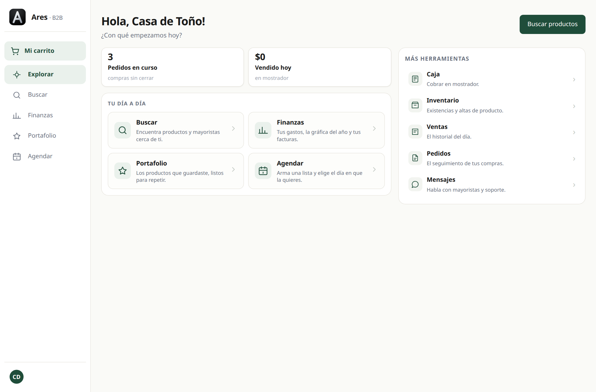
</p>

**Ares** es el sistema operativo de una distribuidora: una tienda B2B donde los comercios de la
colonia (tiendas de abarrotes, cafeterías, fondas) compran a los mayoristas de la zona, con
reparto propio, punto de venta y finanzas en el mismo lugar. PHP 8.2 + MariaDB.

---

## La idea en una frase

Un tendero entra, encuentra lo que le falta cerca de su negocio, lo agrega al carrito, el
mayorista acepta el pedido y un repartidor lo lleva — todo con factura, calificación e
historial.

## Los cuatro personajes

| Quién | Qué hace en Ares |
|---|---|
| **Comercio** | Compra: busca productos, arma su carrito, agenda pedidos, cobra en su caja. |
| **Mayorista** | Vende: publica su catálogo con precios por escala, acepta y surte pedidos, factura. |
| **Repartidor** | Entrega: ve los viajes disponibles, ofrece por ellos, recolecta y entrega con PIN. |
| **Administrador** | Cuida la plaza: aprueba identidades, revisa pedidos, resuelve reclamos, ajusta parámetros. |

## El recorrido de un pedido

1. El comercio busca «azúcar» en **Buscar**: ve solo mayoristas cercanos, con precio final y
   a cuántos kilómetros.
2. Agrega al **carrito**. Si el producto está agotado o el grupo queda por debajo del mínimo
   del mayorista, ese grupo se bloquea y el resumen lo dice con claridad.
3. Confirma en **checkout**: cada grupo por mayorista se convierte en un pedido hijo con
   folio, y del carrito salen solo los productos ya pedidos.
4. El mayorista acepta el pedido y lo lleva por *aceptado → preparando → en camino →
   entregado*.
5. El motor de logística lanza **rondas de reparto** (5/8/12 km) con 3 ofertas por viaje; el
   primer repartidor que acepta congela la tarifa.
6. Recolección y entrega se confirman con **PIN**; el comercio sigue el viaje en el mapa con
   un enlace público.
7. Todo queda en **finanzas** (factura, IVA, ventas) y en el historial de ambos.

---

## Módulos, explicados en palabras

### Explorar y Buscar
La puerta de entrada de cada rol: saludo personal, cifras propias del día y accesos rápidos.
El buscador encuentra por nombre, categoría y distancia; la comparación ignora acentos, así
que «cafe» encuentra «Café molido». Cada tarjeta muestra precio final, unidad de venta y
existencias reales del mayorista.


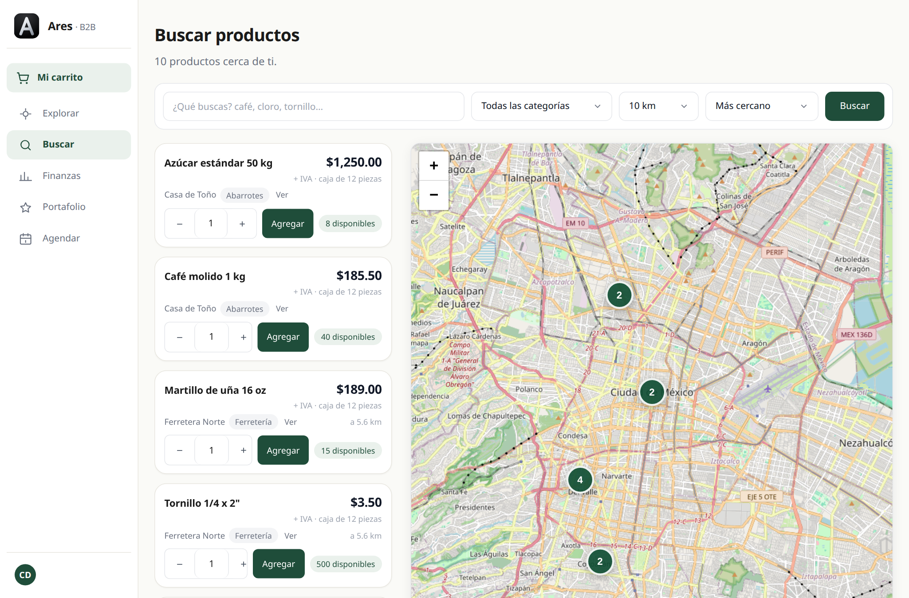

### Carrito y checkout
El carrito vive en un **cajón lateral** que se abre sin recargar la página: recalcula en vivo,
muestra el avance hacia el mínimo de cada mayorista («falta $X») y avisa cuando ya llevas más
de lo que hay en stock. El checkout agrupa por mayorista, revalida stock y mínimos, y de cada
grupo nace un pedido con folio.

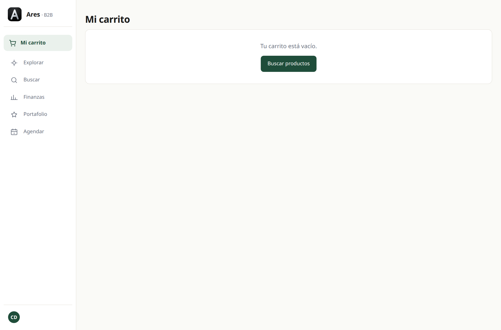

### Pedidos
La bandeja del comercio y del mayorista. Cada pedido tiene folio y estados con transiciones
validadas por rol — nadie salta de «pendiente» a «entregado»— y desglose de líneas con el
precio congelado al momento de la compra, aunque el catálogo suba después.

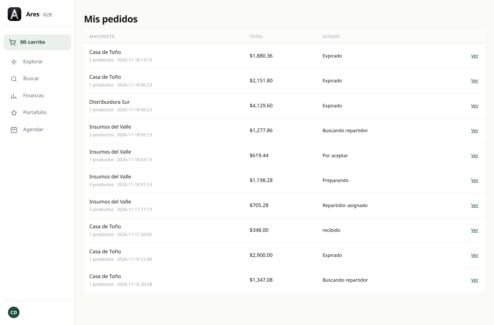

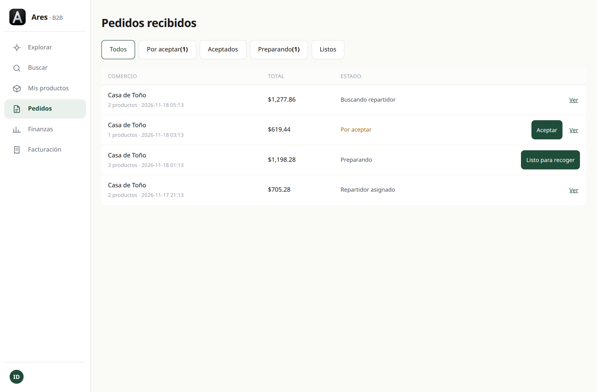

### Catálogo del mayorista
El mayorista administra sus productos con foto, SKU, código de barras, stock y **precios por
escala** (a mayor cantidad, mejor precio por pieza). Para el alta masiva descarga una
**plantilla CSV** con los encabezados exactos y la vuelve a subir: nada de adivinar columnas.

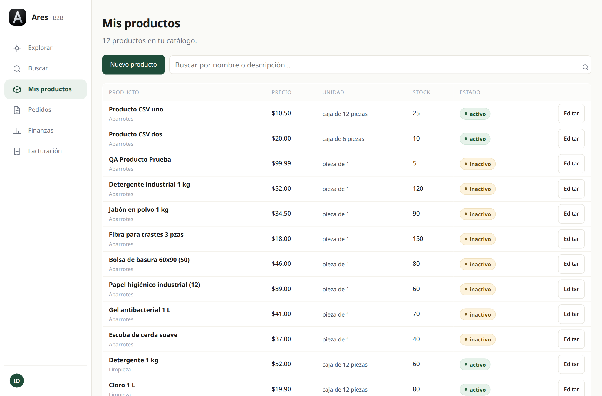

### Finanzas
El estado de cuenta del negocio: ventas, facturas con IVA desglosado, gastos y la gráfica del
año. Es la vista que responde «¿estoy ganando?» sin exportar nada.

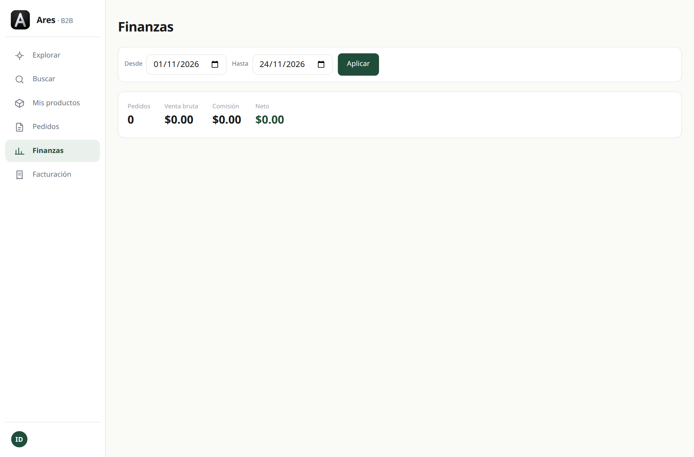

### Reparto (repartidor)
Una sola pantalla con el día completo: viajes disponibles con su tarifa, ofertas enviadas, el
viaje activo y las entregas de hoy. La recolección y la entrega se confirman con PIN; la
posición se reporta en lotes para ahorrar batería.

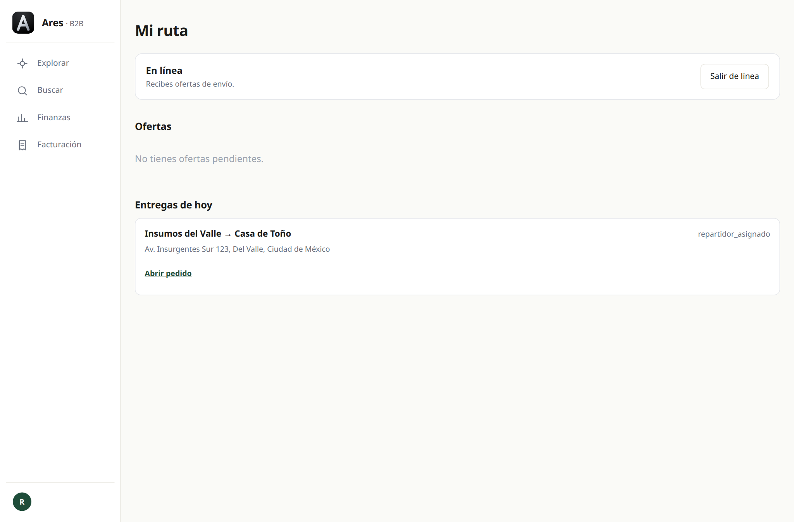

### Punto de venta (Caja)
El POS del comercio: cobrar en mostrador, inventario con alertas de existencias, historial de
ventas, corte de caja y tickets. La búsqueda del catálogo no despliega todo de entrada:
aparece solo al escribir, con tope de resultados y foto por producto.

### Agendar (pedidos programados)
El comercio arma una lista y elige el día: la mercancía llega cuando la quiere, sin volver a
armar el carrito cada semana.

### Mensajes
Centro de conversación entre comercio, mayorista y soporte, más una pestaña de notificaciones
del sitio. Borrar una conversación es **personal**: la otra persona conserva su historial.

### Cuenta, seguridad y permisos
Mi perfil con foto y calificación, edición de datos, verificación de identidad (**KYC**)
revisada por el administrador, privacidad, tema claro/oscuro, y las pantallas de **Seguridad**
(cambio de contraseña) y **Permisos** (qué puede hacer cada rol dentro de la cuenta). La
sesión vive en una cookie firmada; los formularios llevan token CSRF.

### Administración
El panel de la plaza: métricas del día, usuarios y sus roles, cola de KYC por aprobar,
parámetros del sistema (mínimos, tarifas, rondas de reparto) y reclamos.

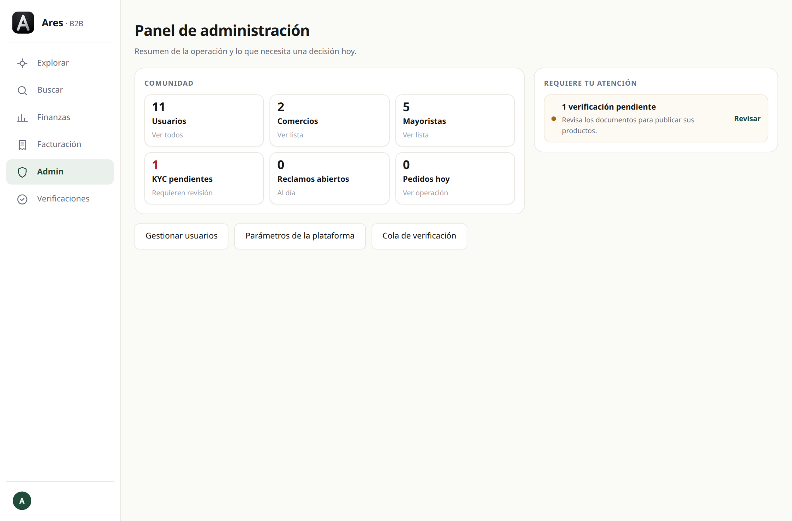

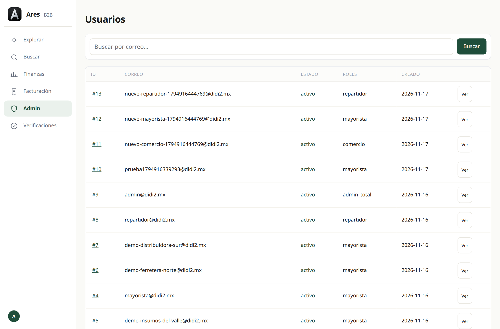

### Facturación
Datos fiscales del mayorista (RFC, régimen, dirección) que se estampan en cada factura
generada desde finanzas. CFDI 4.0 con PAC de práctica.

### La SPA y la API
Junto al sitio clásico vive una **interfaz React** (`/spa`) que consume la misma lógica de
negocio por una **API JSON** (`/api`). No es una reescritura paralela: usa los mismos
servicios de precios, escalas, IVA y reservas de stock, así que lo que cambia en el panel se
refleja en la SPA.

### Post-MVP
Fletes consolidados, crédito BNPL y licitaciones: módulos avanzados de la plataforma ya
esbozados en el panel de administración.

## Diseño móvil

Todo el sistema se usa desde el celular. Bajo 760 px la barra lateral se convierte en una
**barra inferior** con cuatro accesos iguales para todos los roles: Explorar, la pantalla
principal del rol, Mensajes y Cuenta.

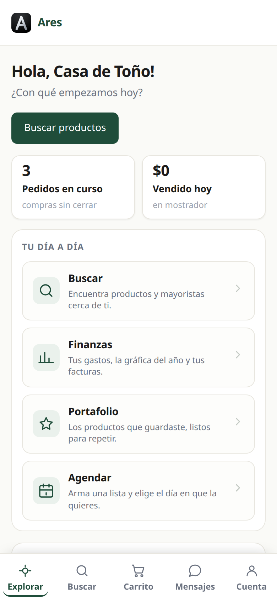

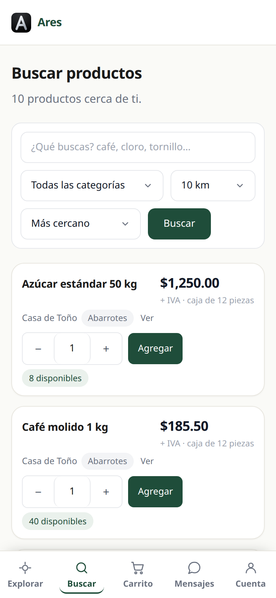

---

## Requisitos

- **PHP** 8.2+
- **MariaDB** 11.x
- **Composer** (las dependencias ya vienen en `vendor/`)

## Instalación rápida

### 1. Clonar el repo
```bash
git clone https://github.com/isairodriguez2025-hub/distribuidora-tienda.git
cd distribuidora-tienda
git checkout Repo-Final
```

### 2. Configurar la base de datos
```bash
sudo systemctl start mariadb

sudo mysql -u root -p << 'SQL'
CREATE DATABASE IF NOT EXISTS didi2;
CREATE USER IF NOT EXISTS 'didi2_app'@'%' IDENTIFIED BY 'tu_password_seguro';
GRANT ALL PRIVILEGES ON didi2.* TO 'didi2_app'@'%';
FLUSH PRIVILEGES;
SQL
```

### 3. Configurar el entorno
```bash
cp .env.example .env
# Editar .env con las credenciales de la BD:
#   DB_HOST, DB_PORT, DB_NAME, DB_USER, DB_PASS
```

### 4. Ejecutar las migraciones
```bash
php bin/migrate.php
```

### 5. Iniciar el servidor
```bash
php -S 127.0.0.1:8000 -t public/
```

La app estará en: **http://127.0.0.1:8000**

## Cuentas demo

| Rol | Correo | Contraseña |
|-----|--------|------------|
| Comercio | `comercio@didi2.mx` | `comercio123` |
| Mayorista (demo) | `demo-insumos-del-valle@didi2.mx` | `demo1234` |
| Repartidor | `repartidor@didi2.mx` | `repartidor123` |
| Admin | `admin@didi2.mx` | `admin123` |

*(El admin no lo crea ningún seed: se inserta a mano con rol `admin_total`.)*

## Estructura del proyecto

```
Repo-Final/
├── public/                  ← Document root
│   ├── index.php            ← Front controller
│   ├── api.php              ← API JSON de la SPA
│   ├── spa/                 ← Build de la interfaz React
│   ├── manifest.json        ← PWA
│   ├── sw.js                ← Service Worker
│   └── assets/              ← Leaflet, CSS, JS, imágenes
├── app/
│   ├── Config/              ← Rutas y configuración
│   ├── Core/                ← Router, DB, Auth, Session, CSRF
│   ├── Modules/             ← Funcionalidad por módulo (Controlador/Servicio/Repositorio)
│   └── Views/               ← Plantillas HTML
├── docs/
│   ├── PLAN-CUENTAS.md      ← Plan de cuentas profesionales
│   ├── images/              ← Capturas del README
│   └── capturas-doc.cjs     ← Generador de las capturas (Playwright)
├── migraciones/             ← Migraciones SQL numeradas
├── tests/                   ← PHPUnit
├── vendor/                  ← Dependencias de Composer
├── .env.example             ← Configuración de entorno (copiar a .env)
└── composer.json
```

## Testing

```bash
php vendor/bin/phpunit tests/Integration/
```

## Despliegue

Ver `DEPLOY.md` para instrucciones de despliegue en producción.

## Tecnologías

- PHP 8.2 (enrutador propio, PDO)
- MariaDB 11.x
- FastRoute
- React 19 + Vite (SPA en `/spa`)
- Leaflet + OpenStreetMap
- PWA (instalable, funciona offline)
- PHPUnit
